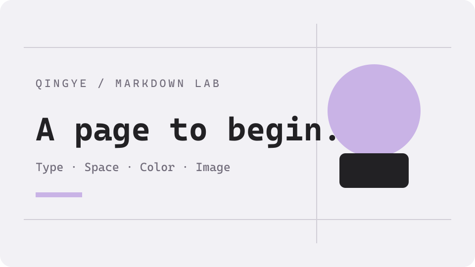
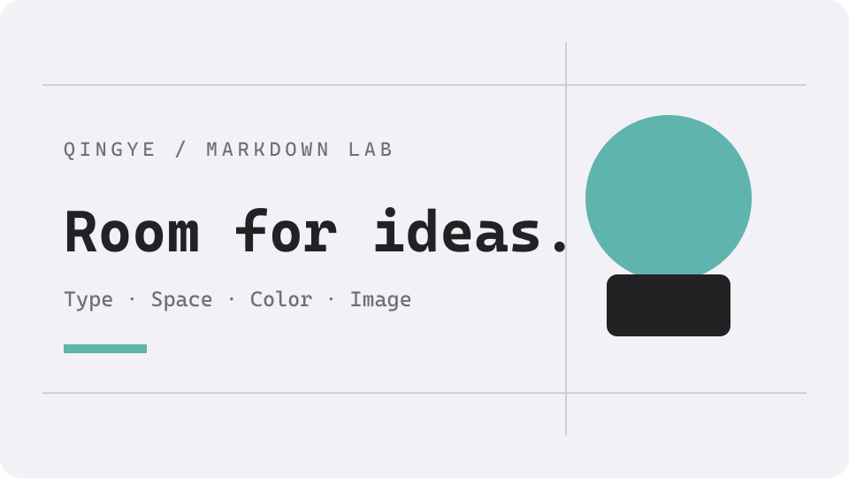
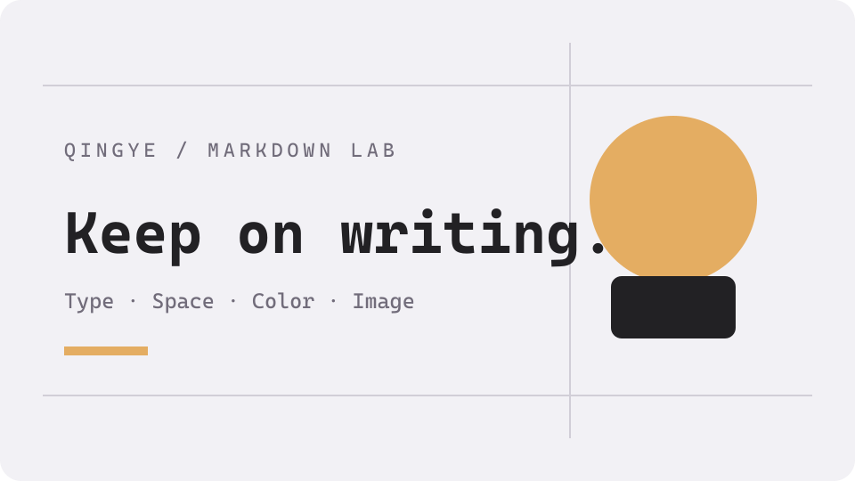

这是青也博客的第一篇文章，也是一份可以随时打开的 Markdown 排版样本。从一段文字、一张图片开始，逐步检查写作时会用到的内容形式。

:::note[如何阅读这篇文章]
左侧或正文上方的目录可以跳转到不同章节。代码右上角可以复制，图片可以点击放大，折叠标题可以展开。页面右侧或右上角可以切换明暗模式。
:::

## 01 标题与段落

下面依次展示 Markdown 的六级标题，检查字号、间距、中文锚点和目录层级。

# 一级标题示例

## 二级标题示例

### 三级标题示例

#### 四级标题示例

##### 五级标题示例

###### 六级标题示例

这是一段中文与 English 混排。Astro、TypeScript、Markdown，以及数字 2026，应当在同一行自然衔接。标点、引号“青也”、书名号《写作手记》，也应该保持清晰的阅读节奏。

这是一行软换行的文字，
源码中的换行会继续组成同一个段落。

这一句后面使用反斜线创建硬换行。\
这一句应该从新的一行开始。

## 02 行内样式与 HTML

这里有 **粗体**、*斜体*、***粗斜体***、~~删除线~~，以及行内代码 `const blogName = '青也'`。

转义后的星号 \*不是斜体\*，转义后的下划线 \_保留原样\_。行内代码中的 `<article> & **Markdown**` 应当显示原始字符。

H<sub>2</sub>O 与 x<sup>2</sup> 展示上下标。<abbr title="HyperText Markup Language">HTML</abbr> 展示缩写提示，<mark>这一段文字被高亮</mark>，<u title="下划线示例">这一段带有下划线</u>。

按 <kbd>Ctrl</kbd> + <kbd>C</kbd> 复制，按 <kbd>Ctrl</kbd> + <kbd>V</kbd> 粘贴。

---

上面的横线用于分隔内容。

## 03 列表、引用与任务

### 无序与嵌套列表

- 写作
  - 记录一个想法
  - 为段落补上例子
- 发布
  - 检查排版
  - 检查链接

### 有序列表

1. 在编辑器中写下标题。
2. 写出正文并添加配图。
   1. 检查图片描述。
   2. 检查图片是否可以放大。
3. 阅读一遍完整页面。

### 任务列表

- [x] 这是一项已经勾选的任务。
- [ ] 这是一项尚未勾选的任务。
- [x] Markdown 任务项应显示为不可编辑的复选框。

### 多层引用

> 记录下来的想法，会成为以后可以重新出发的地方。
>
> > 引用之中还可以继续嵌套引用。
>
> 引用中也可以包含 **强调** 和 `code`。

## 04 链接与脚注

访问 [我的 GitHub](https://github.com/xh20220630)，或使用[引用式链接][github-profile]。自动链接示例：https://github.com/xh20220630 。

也可以使用尖括号链接：<https://github.com/xh20220630>。邮件链接使用示例地址 <hello@example.com>。

[跳转到代码章节](#05-代码与复制) 用于检查文章内的中文锚点。

一句正文可以附带脚注[^render-note]，也可以再次引用同一条脚注[^render-note]。另一条脚注支持更长的说明[^long-note]。

## 05 代码与复制

### TypeScript

~~~ts
type Post = {
  title: string
  draft: boolean
}

const posts: Post[] = [
  { title: '青也的第一篇文章', draft: false },
  { title: '还在写的草稿', draft: true },
]

const publishedTitles = posts
  .filter(post => !post.draft)
  .map(post => post.title)

console.log(publishedTitles)
~~~

复制上面的代码后，可以粘贴到下面的核验区，确认换行、缩进与中文字符是否保留。这个输入框不会提交内容。

<label for="copy-verification">代码复制核验区</label>
<textarea id="copy-verification" aria-label="代码复制核验区" rows="4" spellcheck="false" placeholder="复制上方 TypeScript 代码后，在这里粘贴。" style="box-sizing:border-box;width:100%;padding:0.75rem;border:1px solid currentColor;border-radius:0.25rem;background:transparent;font:inherit"></textarea>

### JSON

~~~json
{
  "name": "青也",
  "theme": "Retypeset",
  "features": ["Markdown", "KaTeX", "Mermaid"],
  "published": true
}
~~~

### Shell

~~~bash
pnpm dev
pnpm build
pnpm preview
~~~

### HTML 与特殊字符

~~~html
<article data-author="青也">
  <h1>你好，Markdown</h1>
  <p>字符 &amp;、&lt;、&gt; 应保留在代码中。</p>
</article>
~~~

### 长代码行

~~~text
https://example.com/markdown-rendering-lab/a-very-long-path-to-check-horizontal-scrolling/another-section?language=zh-CN&theme=retypeset&author=qingye&preview=markdown-rendering-lab
~~~

### 无语言代码块

~~~
这段没有声明语言，不需要语法高亮。
**这些星号应作为代码展示。**
$E = mc^2$ 也不会在代码块里变成公式。
~~~

### 代码块中的 Markdown 代码块

~~~~markdown
```ts
console.log('青也')
```
~~~~

## 06 表格与对齐

| 左对齐 | 居中对齐 | 右对齐 |
| :--- | :---: | ---: |
| Markdown | **支持强调** | 1 |
| 行内代码 | `const value = 42` | 42 |
| 链接 | [GitHub](https://github.com/xh20220630) | 2026 |

下面的宽表用于检查手机端的横向滚动，表格应该在自身区域滚动。

| 项目 | 类型 | 示例路径 | 状态 | 说明 |
| :--- | :--- | :--- | :---: | :--- |
| 文章 | Markdown | /posts/markdown-rendering-lab/ | 正文 | 用于检查长单元格、内边距与滚动 |
| 公开项目 | GitHub | https://github.com/xh20220630/forma-design-studio | 链接 | 较长的地址不应撑开整张页面 |

## 07 图片、图注与画廊

### 本地图片与自动图注

下面的图片来自文章旁边的本地素材，会参与 Astro 图片处理。点击图片可以检查放大效果。



### 隐藏图注

以下图片的替代文本以下划线开头，用于检查隐藏图注的主题约定。


### SVG 图片


### 横向画廊

:::gallery



:::

## 08 数学公式

行内公式 $E = mc^2$ 应与这段正文处于同一条基线。再看勾股关系 $a^2 + b^2 = c^2$。

块级公式：

$$
\int_0^1 x^2\,\mathrm{d}x = \frac{1}{3}
$$

矩阵与分式：

$$
A =
\begin{bmatrix}
1 & 2 \\
3 & 4
\end{bmatrix},
\qquad
A^{-1} = \frac{1}{-2}
\begin{bmatrix}
4 & -2 \\
-3 & 1
\end{bmatrix}
$$

分段函数：

$$
f(x) =
\begin{cases}
x^2, & x \ge 0 \\
-x, & x < 0
\end{cases}
$$

## 09 Mermaid 图表

### 写作流程

~~~mermaid
flowchart LR
    A["写 Markdown"] --> B["构建博客"]
    B --> C{"检查页面"}
    C -- "通过" --> D["发布文章"]
    C -- "调整" --> A
~~~

### 阅读时序

~~~mermaid
sequenceDiagram
    participant Reader as 读者
    participant Blog as 青也
    Reader->>Blog: 打开文章
    Blog-->>Reader: 返回排版内容
    Reader->>Blog: 切换明暗模式
    Blog-->>Reader: 重新绘制图表
~~~

## 10 提示块

以下五种提示使用 GitHub 风格语法。

> [!NOTE]
> 补充说明：这是 NOTE 提示。

> [!TIP]
> 使用建议：这是 TIP 提示。

> [!IMPORTANT]
> 重点信息：这是 IMPORTANT 提示。

> [!WARNING]
> 注意事项：这是 WARNING 提示。

> [!CAUTION]
> 边界提醒：这是 CAUTION 提示。

以下五种提示使用 Retypeset 的容器语法，并带有自定义标题。

:::note[自定义说明]
容器中的 **强调**、`行内代码` 和普通段落应继续渲染。
:::

:::tip[自定义建议]
- 容器也可以包含列表。
- 列表项应保留各自的缩进。
:::

:::important[自定义重点]
这一段使用 important 容器。
:::

:::warning[自定义注意]
这一段使用 warning 容器。
:::

:::caution[自定义提醒]
这一段使用 caution 容器。
:::

## 11 折叠内容

:::fold[展开一段补充内容]
这是折叠块中的正文。**粗体** 与 `inline code` 应继续生效。

- 第一项补充
- 第二项补充
:::

<details>
<summary>展开原生 HTML 折叠内容</summary>
<p>这是原生 details / summary 结构的正文，用于与主题折叠语法对照。</p>
</details>

## 12 GitHub 仓库卡片

这里直接展示一个公开仓库。卡片会尝试更新 GitHub 资料；暂时无法连接时，本站已收录的项目会显示保存的公开资料。

::github{repo="xh20220630/forma-design-studio"}

## 13 音频与视频

### 本地音频

下面的音频使用站点自带的短促提示音，点击播放即可检查浏览器的原生音频控件。

<audio controls preload="metadata" src="/sounds/tap_01.wav" aria-label="Markdown 本地音频测试">
  你的浏览器暂不支持音频播放。
</audio>

### 第三方媒体

这些示例使用主题提供的嵌入语法。展开后可检查外部平台的加载结果；实际播放和完整内容由对应平台提供。

:::fold[查看 YouTube 嵌入示例]
[在 YouTube 打开](https://www.youtube.com/watch?v=9pP0pIgP2kE)

::youtube{id="9pP0pIgP2kE"}
:::

:::fold[查看 Bilibili 嵌入示例]
[在 Bilibili 打开](https://www.bilibili.com/video/BV1sK4y1Z7KG/)

::bilibili{id="BV1sK4y1Z7KG"}
:::

:::fold[查看 Spotify 单曲示例]
[在 Spotify 打开](https://open.spotify.com/track/0HYAsQwJIO6FLqpyTeD3l6)

::spotify{url="https://open.spotify.com/track/0HYAsQwJIO6FLqpyTeD3l6"}
:::

:::fold[查看 Spotify 专辑示例]
[在 Spotify 打开专辑](https://open.spotify.com/album/03QiFOKDh6xMiSTkOnsmMG)

::spotify{url="https://open.spotify.com/album/03QiFOKDh6xMiSTkOnsmMG"}
:::

:::fold[查看 X 推文示例]
[在 X 打开](https://x.com/hachi_08/status/1906456524337123549)

::tweet{url="https://x.com/hachi_08/status/1906456524337123549"}
:::

:::fold[查看 CodePen 嵌入示例]
[在 CodePen 打开](https://codepen.io/jh3y/pen/NWdNMBJ)

::codepen{url="https://codepen.io/jh3y/pen/NWdNMBJ"}
:::

## 14 同名标题与脚注返回

### 同名小节

这是第一个同名小节，用于检查自动生成的锚点。

### 同名小节

这是第二个同名小节，应得到不同的锚点。

## 写在最后

这篇文章会保留在博客中，作为以后写作时可以参考的排版样本。更换字体、调整主题或更新 Markdown 插件后，可以再用它检查页面。

[github-profile]: https://github.com/xh20220630 "青也的 GitHub"

[^render-note]: 这是一条简短脚注。脚注编号应能跳转到底部，并提供返回正文的链接。

[^long-note]: 这是一条包含 **强调文字** 和 `inline code` 的脚注。

    脚注还可以继续包含第二个段落。
